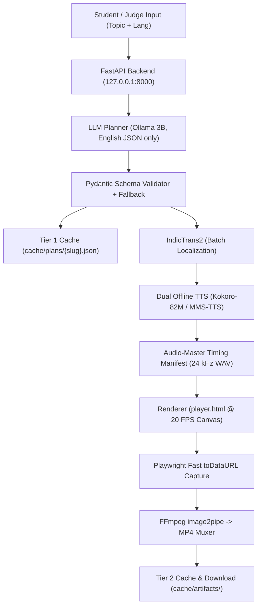

# Blue Visual Teacher

Blue Visual Teacher is a fully offline, air-gapped multilingual educational video generator built for the Unlox Codestorm 24-hour hackathon. Given an educational concept (e.g., "Ohm's Law" or "Photosynthesis"), it produces a 30–90 second synchronized, animated visual lesson that plays in any modern browser and exports as an H.264/AAC MP4 video in English, Hindi, Kannada, Tamil, or Telugu—operating completely offline with zero external API calls or cloud dependencies.

---

## Architecture Diagram



---

## Open-Source Models and Licensing (BLUEPRINT 5.3)

| Component / Artifact | Model ID / Package | Role in Pipeline | License | Compliance & Attribution Notes |
|---|---|---|---|---|
| **LLM Planner** | `llama3.2:3b` / `qwen2.5:3b` via Ollama | English JSON curriculum planning | Llama 3.2 Community / Apache 2.0 | Executed locally via Ollama daemon; no external API calls. |
| **Indic Translation** | `ai4bharat/indictrans2-en-indic-dist-200M` + IndicTransToolkit | English to Hindi, Kannada, Tamil, Telugu | MIT License | Permissive open-source license; includes Cython IndicProcessor. |
| **EN & HI TTS** | `hexgrad/Kokoro-82M` + `misaki` + `espeak-ng` | 24 kHz speech synthesis for English & Hindi | Apache 2.0 | Trained on permissive audio and IPA labels. |
| **KN / TA / TE TTS** | `facebook/mms-tts-kan`, `tam`, `tel` | 16 kHz VITS speech synthesis for Kannada, Tamil, Telugu | CC-BY-NC 4.0 | Non-commercial research/hackathon license; resampled to 24 kHz. |
| **Indic Typography** | Noto Sans (Latin, Devanagari, Kannada, Tamil, Telugu) | Offline script rendering & ligature shaping in Chromium | SIL Open Font 1.1 | Bundled locally in `renderer/assets/fonts/`; zero CDN calls. |
| **Video & Web Stack** | Playwright (Chromium), FFmpeg (`libx264`), FastAPI, Pydantic | Deterministic frame capture, MP4 muxing, schema validation | Apache 2.0 / MIT / GPLv2+ (`libx264`) | Invoked locally via Python subprocess pipes. |

---

## How to Run Offline

### 1. Verify Prerequisites
Run the one-command environment and air-gap readiness check:
```powershell
python exporter/check_env.py
```
This tests Python packages, FFmpeg binaries, Playwright Chromium, Ollama connectivity, local models, and verifies that outbound network connections are not leaking.

### 2. Launch Demo Server
```powershell
.\run_demo.ps1
```
On Linux/macOS:
```bash
bash run_demo.sh
```
This sets `HF_HUB_OFFLINE=1` and `TRANSFORMERS_OFFLINE=1`, pre-warms models, opens `http://127.0.0.1:8000`, and starts the Uvicorn server on a single worker.

### 3. Run Integration Tests
```powershell
pytest tests/test_e2e_offline.py -v -m "not slow"
```

---

## Core Design Decisions

1. **Audio-Master Timing**: Video rendering does not drive audio. Speech synthesis is performed first; each scene's visual duration equals the exact measured duration of its spoken narration audio. This eliminates audio-caption-visual drift by design.
2. **Deterministic Seekable Renderer**: Visual templates render synchronously as a pure function of time via `window.renderAtTime(t_sec)` on a 1280x720 canvas. No `setInterval`, unseeded `Math.random()`, or non-deterministic animation loops.
3. **Data Only, Never Code**: The LLM outputs strict JSON matching `LessonPlan.model_json_schema()`. It never generates Manim, SVG, Python, or JavaScript code.
4. **English Planning + Batched Localization**: The LLM plans strictly in English, avoiding multilingual generation degradation in 3B models. All Indic translations are handled in a single batched call via IndicTrans2.
5. **High-Speed Frame Capture**: Captures frames directly from the canvas via `toDataURL('image/jpeg', 0.90)` and pipes directly to FFmpeg `image2pipe`, bypassing the Chromium compositor for a 2-3x speedup.
6. **Two-Tier Caching**:
   - *Tier 1*: Validated English lesson plans are cached by topic slug in `cache/plans/`, allowing instant generation when switching languages for the same topic.
   - *Tier 2*: Full artifacts (manifest, audio, and MP4) are cached by `(slug, lang)` in `cache/artifacts/`, returning instant cache hits for previously generated lessons.

---

## Team & Workstream Ownership

- **Orchestration & LLM Planning (`orchestrator/`)**: Yyug
- **Visual Engine & Templates (`renderer/`, `web/`)**: Farhan
- **Indic Translation & TTS (`localization/`)**: Tarun
- **Backend API, Exporter, Tests & Automation (`exporter/`, `tests/`, `scripts/`)**: Ayush
